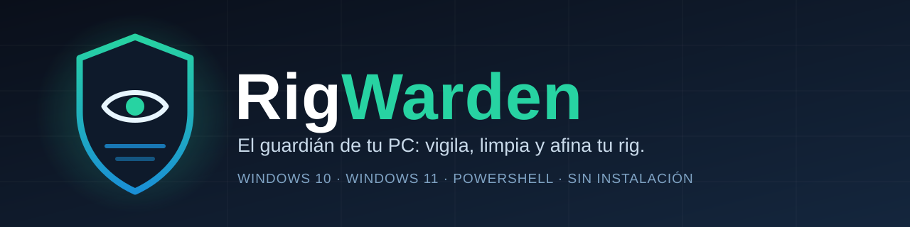

<p align="center">
  
</p>

<p align="center">
  
  
  
  
</p>

**RigWarden** es el guardián de tu PC: una herramienta gratuita para Windows que te enseña **todo lo que se pone en marcha en tu PC**, te explica en lenguaje sencillo **qué es cada cosa y por qué podría ser peligrosa**, y te deja decidir qué mantener, qué desactivar y qué eliminar. Todo lo que cambies se puede deshacer.

Hoy vigila y protege; la **limpieza (debloat)** y los **ajustes para juegos** llegan en las próximas versiones (ver la hoja de ruta).

Nació después de limpiar un PC de juegos infectado con un minero de criptomonedas que se escondía cada vez que se abría el Administrador de tareas. RigWarden está pensada para que cualquiera pueda detectar algo así sin ser experto.

## Empezar

Abre **PowerShell** (clic derecho en el botón de Inicio → *Terminal* o *Windows PowerShell*), pega esto y pulsa Enter:

```powershell
irm https://raw.githubusercontent.com/Jvillado29/rigwarden/main/RigWarden.ps1 | iex
```

Acepta el aviso de Windows para darle permisos de administrador y se abrirá la ventana. No se instala nada: al cerrarla, no queda nada en marcha.

> ¿Prefieres un archivo? Descarga [`RigWarden.ps1`](RigWarden.ps1), haz clic derecho sobre él → **Ejecutar con PowerShell**.

## Qué hace

| Pestaña | Para qué sirve |
| --- | --- |
| **Inicio automático** | Lista lo que arranca solo: registro, carpeta Inicio, tareas programadas, servicios, drivers y suscripciones WMI. Comprueba la **firma digital** de cada archivo, marca en colores lo sospechoso y explica el motivo. Para cada elemento eliges **Mantener**, **Desactivar** o **Eliminar**. |
| **Procesos** | Mide durante 5 segundos qué programas consumen CPU, sin abrir el Administrador de tareas, para pillar a los mineros que se esconden. |
| **Seguridad** | Revisa el antivirus y sus **exclusiones**, bloqueos del sistema, programas sustituidos, Winlogon, firewall, control de cuentas, archivo hosts, proxy, Secure Boot y TPM. Si algo falla, un botón lo soluciona. |
| **Deshacer** | Historial de todos los cambios con su copia de seguridad, para revertirlos uno a uno. También crea puntos de restauración de Windows. |
| **Ayuda** | Qué significan los colores, qué es la firma digital y qué hace cada botón. |

### Cómo se marca el riesgo

| Color | Significa | Ejemplos de lo que lo provoca |
| --- | --- | --- |
| 🔴 **Sospechoso** | Varias señales típicas de malware | Sin firma en `AppData` o `Temp`; dentro de `C:\Windows` sin ser de Microsoft; comandos ocultos o codificados; scripts en carpetas raras; nombres que imitan a Windows |
| 🟡 **Revisar** | Algo no cuadra del todo | Sin firma digital; se lanza con `cmd`, `powershell` o `python`; tarea marcada como oculta |
| ⚪ **Resto** | Apunta a algo que ya no existe | Restos de programas desinstalados |
| **Normal** | Firmado por un fabricante identificado | Steam, Discord, drivers de NVIDIA… |

## Seguridad

- **Nada cambia sin que pulses un botón y lo confirmes.**
- Antes del primer cambio, RigWarden ofrece crear un **punto de restauración**.
- **Desactivar** no borra nada: usa los mismos mecanismos que el Administrador de tareas y el Programador de tareas de Windows.
- **Eliminar** guarda antes una copia: el valor del registro, el archivo, el XML de la tarea o la exportación `.reg` del servicio.
- El historial y las copias se guardan en `C:\ProgramData\RigWarden`.
- **No envía nada a internet.** Solo abre el navegador si pulsas *Buscar en internet* o *Comprobar en VirusTotal*. En ese caso, se envía únicamente la huella SHA-256 del archivo, no el archivo.
- Ejecuta RigWarden **solo desde este repositorio**. Cualquier copia en otra web puede estar modificada.

## Requisitos

- Windows 10 o Windows 11.
- Windows PowerShell 5.1, que viene incluido en Windows, o PowerShell 7.
- Permisos de administrador.

## Limitaciones de la versión 0.1

- La ventana se queda congelada unos segundos mientras analiza. Es normal.
- Los servicios y drivers dentro de `C:\Windows` cuyo fabricante dice ser Microsoft se omiten sin comprobar la firma completa, para que el análisis sea rápido.
- Las suscripciones WMI eliminadas no se pueden restaurar de forma automática; se guarda una copia en texto.
- RigWarden ayuda a revisar, pero **no es un antivirus**: complementa a Microsoft Defender, no lo sustituye.

## Hoja de ruta

- [x] Inicio automático, procesos, seguridad y deshacer
- [ ] **Debloat**: quitar aplicaciones preinstaladas, telemetría y anuncios, explicando cada opción
- [ ] **Gaming**: programación de GPU por hardware, modo de juego, plan de energía y comprobación de Resizable BAR, velocidad de la RAM, TPM y Secure Boot
- [ ] Análisis en segundo plano, sin congelar la ventana
- [ ] Exportar un informe del equipo

## Licencia

[MIT](LICENSE). Úsala, modifícala y compártela libremente.
